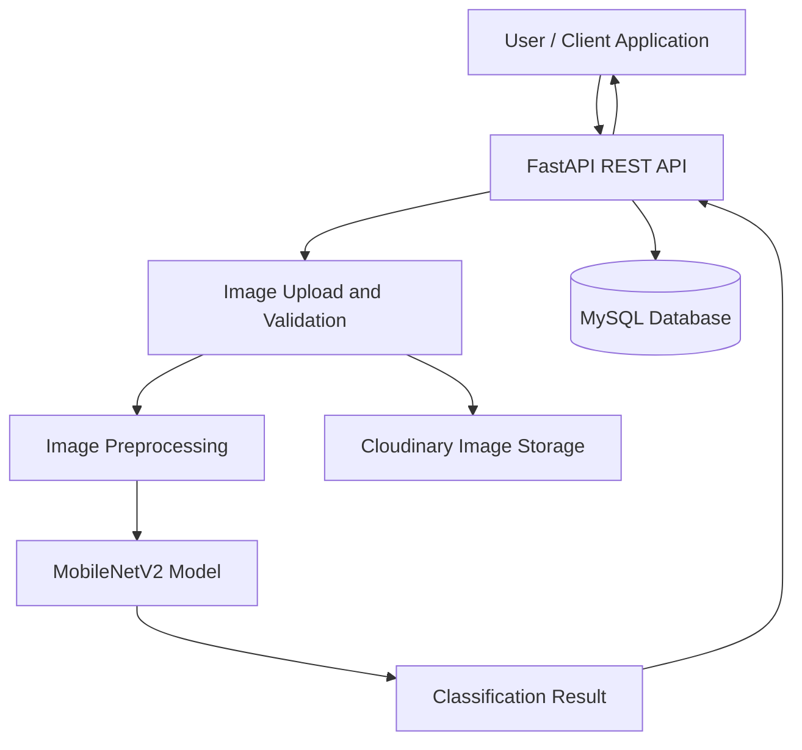

# Areca Nut Grade

**AI-Powered Areca Nut Quality Classification**

Areca Nut Grade is an application designed to classify areca nut quality from images using a deep learning model. The project aims to support a more consistent and efficient grading process by combining computer vision, machine learning, and a web API.

## Overview

Traditional areca nut grading can depend on manual inspection, which may take time and produce inconsistent results. This project explores the use of image classification to help automate the process.

The application uses a **MobileNetV2-based image classification model** to identify areca nut categories and integrates the model into an application backend for prediction and related data management.

## Features

- **AI-Based Classification** — Predicts areca nut categories from uploaded images.
- **MobileNetV2 Model** — Uses a lightweight convolutional neural network architecture suitable for image classification.
- **REST API** — Provides backend endpoints through FastAPI.
- **Image Management** — Supports image upload and cloud-based image storage.
- **Database Integration** — Uses SQLAlchemy for database operations.
- **Authentication Support** — Includes dependencies for token-based authentication and password hashing.
- **Prediction Workflow** — Connects image processing, model inference, and API responses.

## Technology Stack

| Category | Technology |
|---|---|
| Programming Language | Python |
| Backend Framework | FastAPI |
| Machine Learning | MobileNetV2 |
| Model Runtime | LiteRT |
| Database ORM | SQLAlchemy |
| Database Driver | aiomysql |
| Image Processing | Pillow, NumPy |
| Image Storage | Cloudinary |
| Authentication | Python-JOSE, Argon2 |
| Server | Uvicorn, Gunicorn |

## Machine Learning

The project uses **MobileNetV2**, a convolutional neural network architecture designed to provide efficient image classification with relatively low computational requirements.

### Classification Workflow

1. The user uploads an areca nut image.
2. The backend receives and processes the image.
3. The image is prepared for model inference.
4. The trained model generates a classification prediction.
5. The application returns the prediction to the client.

The model's actual accuracy, input dimensions, preprocessing configuration, and output label mapping should be documented alongside the trained model and evaluation results.

## System Architecture



## Project Structure

The following is a suggested overview of the main application components. Update the paths to match the actual repository structure.

```text
ARECA-NUT-GRADE-APPS/
├── app/
│   ├── api/             # API endpoints
│   ├── core/            # Configuration and shared utilities
│   ├── models/          # Database models and ML integration
│   ├── schemas/         # Request and response schemas
│   └── services/        # Application business logic
├── requirements.txt
├── .env.example
└── README.md
```

## Getting Started

### Prerequisites

Make sure you have installed:

- Python 3.10 or a compatible version supported by the project's dependencies
- pip
- MySQL
- Cloudinary credentials
- The trained model artifact required for inference

### 1. Clone the Repository

```bash
git clone https://github.com/AldioYaspindoDev/ARECA-NUT-GRADE-APPS.git
cd ARECA-NUT-GRADE-APPS
```

### 2. Create a Virtual Environment

```bash
python -m venv .venv
```

Activate the environment.

**Linux / macOS**

```bash
source .venv/bin/activate
```

**Windows**

```bash
.venv\Scripts\activate
```

### 3. Install Dependencies

```bash
pip install -r requirements.txt
```

### 4. Configure Environment Variables

Create a `.env` file in the project root and configure the variables required by the application.

Example configuration:

```env
DATABASE_URL=
CLOUDINARY_CLOUD_NAME=
CLOUDINARY_API_KEY=
CLOUDINARY_API_SECRET=
SECRET_KEY=
```

Use the exact variable names expected by the application's configuration. Do not commit real credentials or production secrets to the repository.

### 5. Run the Application

If the FastAPI application instance is exposed as `app` in `main.py`, run:

```bash
uvicorn main:app --reload
```

Replace `main:app` with the actual module and application instance path if the entry point differs.

Once the server is running, open the interactive API documentation at:

```text
http://127.0.0.1:8000/docs
```

## API Documentation

The API is built with FastAPI, which can generate interactive documentation from the application's registered endpoints.

- **Swagger UI:** `/docs`
- **ReDoc:** `/redoc`

Available endpoints depend on the routes implemented in the repository.

## Security Considerations

- Store API credentials and secret keys in environment variables.
- Validate uploaded images and enforce appropriate file-size limits.
- Protect authenticated endpoints with proper authorization checks.
- Avoid exposing sensitive exception details in production responses.
- Restrict access to model files and uploaded assets where necessary.

## Future Improvements

- Add model evaluation metrics, including accuracy, precision, recall, and F1-score.
- Document the training dataset and class distribution.
- Provide confidence scores and prediction explanations.
- Add automated tests for API endpoints and model inference.
- Optimize inference latency and memory usage.
- Add deployment instructions and API usage examples.
- Include sample images and application screenshots.

Developed by [Aldio Yaspindo](https://github.com/AldioYaspindoDev).
